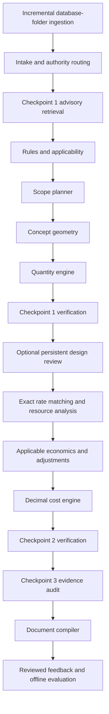

# Architecture and operation

The controller persists typed JSON state through LangGraph. Each revision has its own thread ID and pinned package snapshot. Intermediate results are exposed to the UI. Source documents and generated artifacts live in immutable content-addressed storage; relational rows retain their references.

## Contracts

`ProjectBrief`, `DomainPack`, `DesignRevision`, `BOQItem`, `EvidenceRecord`, `CalculationRecord`, and review/feedback requests are Pydantic contracts. Unknown fields and invalid numeric values are rejected. Decimal quantities and amounts are serialized as strings.

An evidence chain is:

`amount calculation → quantity calculation + rate references → design model + source snapshot + explicit assumptions`.

Every use of a document has a locator-specific evidence record, so several prices from the same schedule do not lose their separate item references. The audit validates evidence references and stored object hashes. Model-assisted semantic review can flag whether text supports a claim; professional validation of new source mappings remains necessary.

## Specialist reasoning

The provider interface is isolated in `providers.py`. Local mode extracts explicit fields and applies reviewed templates. The Anthropic adapter provides a four-turn maximum tool loop with `search_knowledge` and typed `submit_result` tools; the NVIDIA adapter uses `ChatNVIDIA` structured output at temperature zero with no tool loop. Model findings supplement deterministic checks. Prices, measurement expressions, authority package selection and final totals cannot be overwritten by generated text.

When enabled, the one-time Checkpoint 1 retrieval node runs after package routing and before rules. It forms fixed building-norm and component queries, applies tenant/authority/state/date filters, deduplicates and caps passages, and records them as `retrieved` evidence with source hash and page locator. `NVIDIAEmbeddings` uses document/passages for indexing and queries for retrieval; chunks are page-aware and bounded before embedding. NVIDIA reranking is best-effort after hybrid candidate generation. Review output must cite a retrieved evidence ID and an exact quote in that chunk; invalid citations are dropped and counted. Retrieved content is never calculation input and is presented to models as untrusted data. The node is checkpointed before the design-review interrupt, so resume does not retrieve again.

## Retry and interruption policy

- Missing/ambiguous authority or package: stop with `needs_input`; correct inputs or knowledge and create a new revision.
- Unsupported geometry or missing required quantity/rate: complete an `incomplete` report with the known subtotal and visible unresolved lines.
- Duplicate or missing required scope: at most two scope repair cycles; unresolved problems stay blocking.
- Arithmetic mismatch: at most two pricing repair cycles.
- Design review: a persistent LangGraph interrupt. Explicit acceptance resumes pricing; changes are made in a new revision.
- Unexpected execution error: mark `failed`, preserve checkpoints and expose resume.
- Concurrent run requests: a database-backed lease prevents duplicate workers. A lost worker's lease expires after the configured timeout (default 30 minutes). Stage saves renew the lease. Restarted interrupted reviews resume immediately; a process killed during an active run may require lease expiry before retry.

The local UI uses polling. API execution is a background task in the application process, with durable checkpoints and leases. This initial release does not provide a separate distributed queue or worker fleet. Use a dedicated task service when deploying sustained multi-user workloads; retain revision IDs as idempotency keys.

## Pricing boundaries

Scheduled and non-scheduled rate bases are distinct from fixed, quantity-dependent and duration-dependent cost behavior. Exact rate candidates are stored in numeric relational columns and selected by unit, specification and effective date. No generic inflation number is applied without a reviewed adjustment record.

Adjustments are additive to their explicitly eligible base line amounts. They do not compound implicitly. `group` prevents overlapping adjustments on the same item/scenario, and rate inclusions prevent adding the same overhead or tax twice. More complex statutory calculation sequences need an additional reviewed deterministic policy before use.

Selected optional items enter the selected-scope total. Unselected options have their own subtotal. Scenario totals are shown only for a complete base estimate. A known subtotal never implies unresolved items cost zero.

## Governance and deployment

API keys map to server-defined tenants and roles. All project, document, feedback, package and artifact access is scoped by tenant. Clients cannot choose their tenant in a request body. Viewer access is read-only; estimate review requires a reviewer/admin; package approval requires an admin. The unprotected demo mode is for a trusted local user.

Public web searches contain catalog authority and component names, not project descriptions. Downloads are limited to configured HTTPS hosts and reject private-network targets and redirects to unapproved hosts. Retrieved sources remain candidates. For production, enforce outbound network policy at the infrastructure layer as well.

Local object storage uses atomic, content-addressed writes. S3 uses the same object keys; configure bucket versioning, retention, encryption and access controls in the hosting environment. Original source snapshots are served only through tenant-authorized API routes.

## Delivery boundaries

The application implements the complete three-checkpoint path for configured rectangular-building packages and rejects unsupported cases explicitly. Live model reasoning, embeddings, web search and S3 require credentials or services supplied by the operator. Government documents, actual schedules, adoption mappings, validated engineering recipes and reference estimates are not bundled. No national/state/railway compliance certification is implied by the software or its demonstrations.

External database migration, production identity federation, scanned-PDF OCR, arbitrary CAD/BIM interpretation, structural analysis, bridge/track geometry and tender publication are outside this initial implementation. These can be integrated through the existing source, domain-package and provider interfaces.
